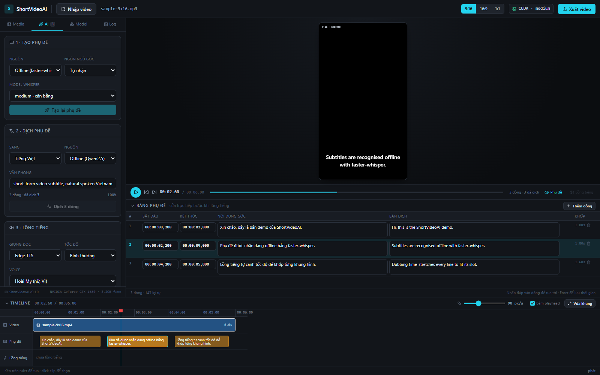
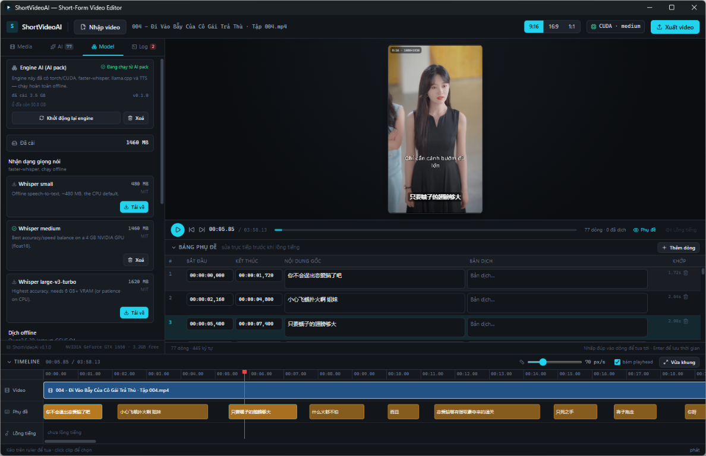

# ShortVideoAI

> English | [Tiếng Việt](README.md)

Windows-first short-form video editor: import a vertical clip, transcribe it offline,
translate the subtitles, generate a time-fitted dub, and export the final MP4 — all on
the local machine.

**Stack:** Tauri v2 + React 19 + TypeScript + Vite + Tailwind + Zustand →
FastAPI engine (Python 3.12) → FFmpeg + faster-whisper + llama.cpp (Qwen2.5 / Gemma 3) +
CapCut TTS / OmniVoice / VoiceStudio + audio-separator.



---

## Contents

- [Features](#features)
- [Requirements](#requirements)
- [Quick start (development)](#quick-start-development)
- [First AI run: models](#first-ai-run-models)
- [Online providers and settings](#online-providers-and-settings)
- [Configuration](#configuration)
- [Data, models and logs](#data-models-and-logs)
- [Production build](#production-build)
- [Optional AI pack](#optional-ai-pack)
- [How the packaged app runs](#how-the-packaged-app-runs)
- [Verification scripts](#verification-scripts)
- [Project layout](#project-layout)
- [Troubleshooting](#troubleshooting)

---

## Features

| # | Feature | Implementation |
|---|---------|----------------|
| 1 | Import & preview short videos, 9:16 / 16:9 / 1:1 | HTML5 player over the Tauri `asset://` protocol, subtitle overlay drawn inside the frame |
| 2 | Automatic subtitles, offline by default | faster-whisper (CTranslate2) with VAD; optional Groq / OpenAI cloud STT, CapCut / Bilibili BCut, or OCR for burned-in subtitles (speed vs accuracy profiles); a misread cue can be re-read from its own frame, with a confirmation before it replaces the line |
| 3 | Multi-language translation, timestamps preserved | Qwen2.5 3B or Gemma 3 4B (GGUF) via llama.cpp locally — picked in the **Dịch offline** section of the **Cài đặt** tab — or Gemini / OpenAI |
| 4 | Automatic dubbing fitted to each line | CapCut (cloud, default) / OmniVoice (k2-fsa, offline on torch) / VoiceStudio (local OpenAI-style server) + FFmpeg `atempo`, speed ratio clamped to `SVA_MAX_TEMPO_RATIO` (1.35); the clip's own soundtrack is kept and ducked under the dub; any single line can be played back or re-spoken and spliced into the track without dubbing the clip again |
| 5 | Final render | FFmpeg: crop/scale to the chosen aspect, burn ASS subtitles, mix the dub over the background track; caption font, colours and placement are edited in the app, and the subtitles also export as styled `.ass` or plain `.srt` |
| 6 | Save / open projects, nothing lost on restart | `.svaproj` JSON holds the clip, subtitles, translations, dub track, settings and playhead; `Ctrl+S` / `Ctrl+Shift+S` / `Ctrl+O`; every change is also autosaved to `projects\_session.json` and restored on the next launch |
| 7 | API keys and model names entered in the app | **Settings** tab → `<data>\settings\providers.json`: per-provider key, custom endpoint, free-text model names, plus a live connection test that lists the models the key can reach |
| 8 | Hand the project over to CapCut | `POST /api/export/capcut` writes a real CapCut Desktop draft (`draft_content.json` + `draft_meta_info.json` + an entry in `root_meta_info.json`): the clip, one text clip per cue and one audio clip per dubbed line sit on separate tracks, so they can be retimed, restyled or re-voiced in CapCut instead of arriving as a burned-in MP4 |

Extras: model manager with streaming downloads and live progress, GPU auto-detection
(CUDA/float16 vs CPU/int8), live job progress over WebSocket, editable subtitle table,
three-track timeline, engine sidecar supervised by the desktop shell.

---

## Requirements

| Tool | Version | Notes |
|------|---------|-------|
| Windows | 10/11 x64 | WebView2 runtime (preinstalled on Windows 11) |
| Node.js | ≥ 20.19 | `node --version` |
| Python | 3.12 | `py -3.12`; the setup script refuses older interpreters |
| Rust | ≥ 1.77.2 | `cargo --version`, MSVC toolchain (only needed for the desktop shell / builds) |
| FFmpeg | any recent build | `winget install Gyan.FFmpeg`; bundled into the installer automatically |
| GPU | optional | NVIDIA with CUDA 12.x for `cu130` torch wheels; CPU works with smaller models |

Disk: ~5 GB for the development environment, ~10 GB of free space for a `full` engine
build (work directory + 3.5 GB bundle). The AI models are downloaded separately (see below).

---

## Quick start (development)

```powershell
# 1. Install everything (venv, Python deps, AI stack, ffmpeg, Rust check, npm install)
npm run setup

# 2. Verify the environment
npm run check

# 3. Start the engine + the desktop shell
npm run dev
```

`npm run dev` runs two processes concurrently:

- `npm run dev:backend` — FastAPI on `http://127.0.0.1:8756` (uvicorn `--reload`)
- `npm run dev:app` — `tauri dev` (Vite on `http://localhost:1420`, Rust debug build)

### UI-only development

If you do not need the desktop shell (no file pickers, browser playback via `file://`):

```powershell
npm run dev:backend     # terminal 1
npm run dev:web         # terminal 2 -> http://localhost:1420
```

Append `?demo` to the URL (`http://localhost:1420/?demo`) to load the bundled sample
clip into the timeline, subtitle table and overlay without importing a file.

### Setup options

```powershell
npm run setup -- -CoreOnly     # server deps only, no torch / AI wheels
npm run setup -- -SkipAi       # torch only, skip whisper / TTS / LLM packages
npm run setup -- -ForceCpu     # install the CPU torch build on purpose
npm run setup -- -SkipRust     # skip the cargo pre-check
npm run setup -- -OcrGpu       # GPU OCR: swap ONNX Runtime for the DirectML build
npm run setup -- -OcrCuda      # GPU OCR: swap it for the CUDA build (NVIDIA + cuDNN 9)
```

The script is idempotent: every step is skipped when already satisfied.

---

## First AI run: models

Weights are **not** in the repository. Open the **Model** tab in the app and download
what you need (`%APPDATA%\ShortVideoAI\models`):

| Group | Key | Size | Needed for |
|-------|-----|------|------------|
| stt | `whisper-small` / `whisper-medium` / `whisper-large-v3-turbo` | 480 MB / 1.5 GB / 1.6 GB | local transcription (the size follows `SVA_GPU_PRESET`) |
| llm | `qwen2.5-3b-instruct-q4_k_m` | ~2 GB | offline translation, the default — fastest per line |
| llm | `gemma3-4b-it-q4_k_m` | ~2.4 GB | offline translation, Google's 4B — slower per line, picked in the **Dịch offline** section of the **Cài đặt** tab |
| tts | `omnivoice-v1` | 3.3 GB | optional offline voices: `pip install omnivoice` for the runtime, the `k2-fsa/OmniVoice` snapshot lands in `models\tts\omnivoice-v1` on the first dubbed line. The default is still CapCut (internet only) and VoiceStudio (its own server, see below) |
| separator | `uvr-mdx-inst-hq3` | 110 MB | keeping background music under the dub, and the **Giọng sạch** audio mode for subtitle extraction |
| ocr | `ocr-ppocrv6-tiny` | 31 MB | optional fast OCR profile (det tiny + rec small); the default `small` pair ships with the OCR engine |
| ocr | `ocr-korean-v5` | ~30 MB | Korean burned-in subtitles (PP-OCRv6 has no Korean recogniser yet) |

Downloads stream through the engine with live progress into a `.part` file and are
promoted only when complete, so an interrupted download never leaves a corrupt weight
file (a cancelled download restarts from the beginning).
Cloud providers (Groq / OpenAI / Gemini) need only API keys — no models; CapCut and VoiceStudio
are plain HTTP calls, so they have no weights either.

---

## Online providers and settings

Cloud AI no longer depends on `backend/.env`: the **Cài đặt (Settings)** tab writes
`<data>\settings\providers.json` through `GET/PUT /api/settings`, and every service
overlays that document when it runs. Precedence is **stored value wins, environment
only seeds**: on first launch `SVA_*` / `GROQ_API_KEY` … are copied into the document
so an existing `.env` shows up pre-filled, and from then on what the panel shows is
what runs.

Per provider (Gemini, OpenAI, Groq, VoiceStudio) the panel takes an API key, an optional
custom endpoint (proxy, regional host or OpenAI-compatible gateway) and free-text model
names, so a model released tomorrow works without an app update. **Kiểm tra** sends one
real request and lists the model ids the key can reach; clicking an id fills the field.
The key itself never leaves the engine — the API only reports `api_key_set`.

For Gemini the engine also shapes each *request* from the selected model, because a
free-tier quota is spent per request: `gemini-3.1-flash-lite` batches 40 lines with
`ThinkingLevel.MINIMAL` and waits 4 s between calls — the cheapest shape for long series and
simple subtitles; `gemini-4-hydrogen` batches 28 lines with `ThinkingLevel.LOW` and waits 3 s,
which keeps dialogue, address forms and the film's tone — the pick for drama and documentary.
Any other id (2.5 Flash/Pro, a proxy's own model) keeps a 20-line batch and sends no thinking
level, because the 2.5 family takes a *budget*, not a *level*. The gap counts quiet time after
the previous answer arrived, so a slow request is not punished twice, and a cancel during the
wait still stops the job.

| Panel | Stores | Used by |
|-------|--------|---------|
| API key & model online | `providers.<name>.{api_key, base_url, model, stt_model}` | translation (Gemini / OpenAI), speech-to-text (Groq / OpenAI), dubbing (VoiceStudio) |
| Offline translation (GGUF) | `llm.model` | picks the weights for the `local` provider: `qwen2.5-3b-instruct-q4_k_m` (default) or `gemma-3-4b-it-q4_k_m`; an empty string returns to the default. Each GGUF loads with its own chat template — chatml for Qwen, `<start_of_turn>` for Gemma (Gemma has no system role, so the address-form rules ride in the user turn) — and switching models releases the old one from VRAM before the new one loads |
| OCR | `ocr.engine`, `ocr.profile`, `ocr.region`, `ocr.device` | `small` = PP-OCRv6 small detector + recognizer, ships with the engine, most accurate; `tiny` = tiny detector + small recognizer, about twice as fast, needs the `ocr-ppocrv6-tiny` download. Korean always routes to PP-OCRv5, Japanese under `tiny` falls back to the small detector. `ocr.region` is the scan rectangle `left,top,right,bottom` in percent of the frame — logos, channel names and ad text outside it are never read as subtitle lines; an empty string returns to the default band (`0,55,100,100`). `ocr.device` = `auto` / `gpu` / `cpu` picks where the frames are read |
| Âm thanh khi lấy phụ đề | `audio.mode` | `fast` transcribes the mix; `clean` separates the vocal first (`uvr-mdx-inst-hq3` via audio-separator), denoises it (`afftdn` + `loudnorm`) and transcribes a 16 kHz mono vocal — CapCap's trick for clips whose music drowns the dialogue. Missing package or weights degrade to `fast` with a warning instead of failing |

The OCR engine reads weights from `<data>\models\ocr` once that folder holds `*.onnx`
files, so a fresh install keeps using the bundled pair and never downloads on first run.

The rectangle is drawn inside the panel at the real aspect of the open video (9:16, 16:9,
1:1): drag to pick it, type the four percentages for precision, or press a preset (*Dưới 45 %* /
*Dưới 30 %* / *Trên 30 %* / *Toàn khung*). Press **Vùng OCR** in the preview transport to draw it
straight on the video: everything outside the box dims, the measurement follows the video pixels
(so a 16:9 clip inside a 9:16 project stays correct), and releasing the mouse saves it. Every
sampled frame is cropped by FFmpeg before OCR, so nothing outside the box costs recognition time
or can turn into a junk line; a broken stored value is ignored with a warning and falls back to
the default band instead of failing the job.

Reading frames is the slow half of OCR, so `ocr.device` defaults to `auto`: the engine uses the GPU
whenever the installed onnxruntime build exposes a graphics provider and stays on the CPU otherwise.
All three ONNX Runtime distributions (`onnxruntime`, `onnxruntime-directml`, `onnxruntime-gpu`)
install the **same** `onnxruntime` module, so "use the GPU" is a *wheel swap*, never an extra
requirement:

```powershell
npm run setup -- -OcrGpu     # DirectML — any DX12 card (NVIDIA, AMD, Intel), no CUDA needed
npm run setup -- -OcrCuda    # onnxruntime-gpu — NVIDIA + CUDA 12 + cuDNN 9

# or by hand, after requirements-ai.txt is installed:
pip uninstall -y onnxruntime onnxruntime-directml onnxruntime-gpu
pip install -r backend/requirements-ocr-gpu.txt
```

DirectML needs no CUDA runtime, which makes it the safe pick on ordinary laptops; the CUDA build is
faster once CUDA 12 + cuDNN 9 are already on the machine. `pip install -r requirements-ai.txt` (or
`npm run setup` without a flag) puts the CPU wheel back (`requirements-ai.txt` pins `onnxruntime`), so re-run the AI stack
with `-OcrGpu` / `-OcrCuda` — without a flag the script keeps whichever build is installed. Choosing
`cpu` in Settings never touches the GPU even when a GPU wheel is installed; choosing `gpu` is a
*preference*: while the engine loads, one blank frame is read as a warm-up, and if the driver or the
CUDA runtime is missing the reader is rebuilt on the CPU with a warning instead of failing mid-job.
The Settings panel states what actually runs (**Đang đọc bằng GPU / CPU**, plus the ONNX pack and its
providers), and the job log names `rapidocr · GPU` or `rapidocr · CPU`.

A line that came out wrong — through the speech engine or through the OCR — does not need the whole
clip re-read: press the **scan** icon on that cue in the subtitle table, or the one in the table header
to re-read the cue currently selected on the timeline (the cue becomes selected and
the playhead jumps to its start). The engine reads 1–3 frames from the middle of the cue's own window,
with the same scan rectangle and the same configured engine, through `POST /api/subtitles/ocr-frame`.
The answer lands in a confirmation dialog: the frame that was just read (the exact crop handed to the
OCR, so a misplaced rectangle is obvious), the current line and the new reading — editable by hand,
and pickable when the frames disagreed. Only **Thay thế dòng này** writes to the subtitles: the
original text changes, the timings stay; the old translation is kept so the line still needs
translating, and the dub track is flagged for a re-run. **Giữ nguyên** leaves everything untouched.
When the rectangle found no text at all, the dialog says so — adjust the region in Settings and press
**Đọc lại**.

### Listen to and re-speak one line

Editing a line no longer means dubbing the whole video again. Every cue in the subtitle table carries
two voice buttons:

- **Speaker** — hear that line. A line with a take plays its own file and nothing is generated; dubs
  recorded before takes were tracked fall back to the `line_NNN.aligned.wav` sitting next to the
  track. Only when no file exists at all is the line spoken once, and that audition says **exactly
  what the cue says** — no rewording to fit the slot (that step loads the translation model) and
  nothing written to the track. Press again to stop; importing another video stops it too.
- **Circular arrow** — speak that line again and splice it into the track. Only this line is
  synthesised (measured against its own window, with the same `atempo` fitting and the same
  shortening for over-long lines as a full dub), every other line keeps the file it already has, and
  the track is rebuilt from scratch through `POST /api/dubbing/remix`. It needs a dub to exist first;
  a line added after the dub splices in fine.

Both call `POST /api/dubbing/cue` with `audition: true` (listen only) or `audition: false` (keep the
take). Each take sits next to the track in the temp folder of its dubbing run and its path is stored in
the project's `dub.segments[].clip_path`, so reopening the project keeps the lines playable.

Every take also remembers the words it was given before any shortening (`source`), so a line whose
text changed while its audio is still the old cut turns the arrow **amber** — one press re-speaks just
that line. The “needs a re-dub” dot in the table header only clears once every line matches again,
even when several lines were edited before being re-spoken one by one.

### Caption style, position and file export

The **type** icon in the subtitle table header opens the look panel: font (type any installed face,
suggestions provided), size, text and outline colour, bold, outline weight, a text background with its
colour and opacity, top / middle / bottom placement, left / centre / right alignment, and the distances
to the edges. Every change shows up in the preview immediately and is written to the project
(`subtitle_style`), so the look survives a restart.

That same look is written into the `.ass` file at render time — the burn-in and the preview share one
set of numbers (size as a percentage of frame height, margins in percent, `BorderStyle 3` for the box) —
so what you watch is what you export.

The **.ass** / **.srt** buttons in that panel export the subtitles as a standalone file through
`POST /api/subtitles/export`: `.ass` carries the current font and placement (CapCut, Premiere, ffmpeg),
`.srt` is plain text for YouTube and everywhere else. The file goes wherever you pick, next to the
source video by default.

### Hand-off to CapCut

The **CapCut** card in the **Media** tab (*Xuất sang CapCut*) does not render a video: it writes a real
CapCut Desktop project. The engine finds the drafts folder of the installed app
(`%LOCALAPPDATA%\CapCut\User Data\Projects\com.lveditor.draft`), creates a new draft folder and
appends it to the project list in `root_meta_info.json`, so the project is waiting on CapCut's home
screen the next time it opens.

Everything inside the draft stays editable, because every part is its own clip:

| Track | Content |
|-------|---------|
| Video | The source clip, referenced in place (never copied) and fitted to the chosen aspect |
| Captions | One text clip per cue: words, font, colours, outline, background, placement and size taken from the look panel |
| Dub | One audio clip per dubbed line at its own timestamp, with the original soundtrack underneath at `background_gain` |

Worth knowing:

- Caption size uses the same numbers as the ASS burn-in (4.2 % of the frame height × the slider), so
  the draft and the app agree on how big a line is.
- CapCut allows no two overlapping segments on one track, so overlapping cues are spread over extra
  tracks (reported in the result).
- `GET /api/export/capcut/targets` reports the drafts folder, the installed version, how many projects
  the index holds and whether CapCut is running. Exporting while it runs still works, but CapCut has to
  be restarted to list the new project: it rewrites the index on exit.
- Before touching `root_meta_info.json` the engine keeps a verbatim copy in
  `<data>\cache\capcut_index_before_<draft_id>.bak`; if CapCut rewrote the list during the export, that
  export stops and the draft stays on disk untouched.
- Without CapCut installed the draft is written to `<data>\exports\capcut\` — copy the whole folder into
  CapCut's drafts folder to use it. The **Chọn…** button points the export somewhere else instead.
- CapCut stores the font as an absolute path, so a machine missing that face still opens the draft and
  a warning reminds you to pick the font again in CapCut.

---

## Configuration

Copy the template and edit it — the engine reads `backend/.env` at startup:

```powershell
Copy-Item backend\.env.example backend\.env
```

Frequently changed values:

| Variable | Default | Meaning |
|----------|---------|---------|
| `SVA_PORT` | `8756` | dev engine port (the packaged app picks a free port itself) |
| `SVA_DEVICE` | `auto` | `auto` / `cuda` / `cpu` / `directml` |
| `SVA_GPU_PRESET` | `max` | `max` (medium whisper fp16 + LLM on GPU), `safe`, `cpu` |
| `SVA_MAX_TEMPO_RATIO` | `1.35` | hard cap for the dubbing speed-up |
| `SVA_STT_PROVIDER` | `local` | `local` / `groq` / `openai` |
| `SVA_TRANSLATE_PROVIDER` | `local` | `local` / `gemini` / `openai` |
| `SVA_TTS_PROVIDER` | `capcut` | `capcut` / `omnivoice` / `voicestudio` |
| `SVA_OMNIVOICE_LANGUAGE` | `vi` | language OmniVoice reads (`vi`, `en`, …); declaring it keeps the model from guessing on homographs |
| `SVA_SOURCE_LANGUAGE` / `SVA_TARGET_LANGUAGE` | `auto` / `vi` | transcription source and translation target |
| `GROQ_API_KEY`, `OPENAI_API_KEY`, `GEMINI_API_KEY` | – | only for cloud providers; these *seed* `providers.json` on first launch (enter keys in the **Settings** tab instead) |
| `SVA_AI_PACK_URL` | – | default AI pack download shown in **Model → Engine AI** (see below) |

Keys, model names, the OCR profile and the audio mode are normally entered in the
**Settings** tab. The variables above are read once, to pre-fill that document; after
that the document wins, and clearing a key in the UI falls back to the environment.

Frontend overrides (`.env.local` in `frontend/`): `VITE_BACKEND_PORT`,
`VITE_BACKEND_HOST`, `VITE_API_TIMEOUT_MS`.

---

## Data, models and logs

Everything the engine writes lives outside the install directory:

```
%APPDATA%\ShortVideoAI\
├── models\        Whisper / LLM / TTS / separator / OCR weights
├── cache\         decoded audio, intermediate wav, a copy of root_meta_info.json before each CapCut draft
├── settings\providers.json  API keys, model names, OCR profile, audio mode
├── projects\      project files: `<name>.svaproj`, `_session.json` (autosave), `audio\` (per-project dub tracks)
├── renders\       exported videos
├── exports\capcut\  fallback draft folder for machines without CapCut
├── logs\engine.log  rotating log (the only log in the packaged app)
├── ai-pack\       optional AI engine (only when installed from the Model tab)
└── temp\          dub tracks, ASS files, thumbnails
```

The packaged app runs windowed (`--noconsole`), so **`logs\engine.log` is the place to
look** when something fails; the error banner in the UI prints the same path.

---

## Production build

Two profiles:

| Flavor | Engine size | Contents |
|--------|-------------|----------|
| `core` (default) | ~110 MB | server, REST/WS API, FFmpeg pipeline, model manager. AI stages fail with an explicit *"needs faster-whisper / llama-cpp-python …"* error until the optional AI pack is installed |
| `full` | ~3.5 GB | everything above + torch/CUDA, CTranslate2, llama.cpp, ONNX Runtime, audio-separator, plus the cloud SDKs used by the online providers (`openai`, `google-genai`) |

```powershell
# Engine only (PyInstaller onedir, noconsole) + smoke test on /api/health
npm run build:backend             # core  (~2 min)
npm run build:backend:full        # full  (5-20 min, ~3.5 GB)

# Full release: engine -> Vite build -> Tauri release -> NSIS installer
npm run build:windows             # core
npm run build:windows:full        # full
```

Artifacts:

```
frontend/src-tauri/resources/engine/    shortvideoai-engine.exe + _internal\
frontend/src-tauri/resources/ffmpeg/    ffmpeg.exe, ffprobe.exe (copied from PATH)
frontend/src-tauri/target/release/      short-video-ai.exe (+ engine\, ffmpeg\)
release/ShortVideoAI_0.1.0_x64-setup.exe
```

`build_windows.ps1` prints the installer size and SHA256. Useful switches:

```powershell
powershell -File scripts/build_windows.ps1 -Flavor core -SkipBackend   # reuse the engine bundle
powershell -File scripts/build_backend.ps1 -Clean -SkipSmokeTest       # clean rebuild, no launch test
```

> **Size limit:** NSIS is a 32-bit container and cannot produce an installer larger than
> 2 GB, so the `full` profile is not shippable as a single NSIS package. Ship the `core`
> installer plus the optional AI pack described below (`-SkipBundle` still builds the app
> without an installer if you prefer a portable folder).

---

## Optional AI pack

The `core` installer (~161 MB) runs the whole editor: timeline, preview, FFmpeg pipeline,
model manager and the API. The AI stack — torch/CUDA, CTranslate2, llama.cpp, ONNX Runtime,
audio-separator — cannot fit in NSIS, so it ships as **one zip installed on demand**.

```powershell
npm run build:pack                       # reuses build\dist-full\engine
powershell -File scripts\make_ai_pack.ps1 -BuildEngine      # PyInstaller first (5-20 min)
powershell -File scripts\make_ai_pack.ps1 -Level 9 -Force   # smaller archive, slower
```

Output: `release\ShortVideoAI_0.1.0_ai-pack-full.zip` (≈2.1 GB, ~3.5 GB unpacked) plus its
SHA256. The archive is a plain copy of the `full` engine bundle:

```
ai-pack.json                     schema, version, profile, file/byte counts
engine\shortvideoai-engine.exe   full-profile PyInstaller bundle
engine\_internal\...
```

Host it anywhere HTTPS and point the engine at it (or leave it empty and let users pick a
local `.zip`):

```ini
SVA_AI_PACK_URL=https://example.com/ShortVideoAI_0.1.0_ai-pack-full.zip
```



Install it from **Model → Engine AI**. The work is split in two on purpose, because Windows
locks a running `.exe` and its DLLs:

| Step | Owner | Result |
|------|-------|--------|
| Download | Python engine | streamed to `temp\ai-pack-<ts>.zip` (no resume — restarts on failure) |
| Verify + extract | Python engine | `ai-pack.staging\engine\...`, progress over `/ws/progress`, needs ~7 GB free |
| Apply | Tauri shell (`apply_ai_pack`) | kills the sidecar, replaces `ai-pack\engine`, moves the manifest, respawns |
| Return to core | Tauri shell (`remove_ai_pack`) | deletes `ai-pack\`, respawns the bundled engine |

The supervisor prefers `%APPDATA%\ShortVideoAI\ai-pack\engine\shortvideoai-engine.exe` and
falls back to `resources\engine\`, so uninstalling the pack is a folder delete. After a swap
the WebView reloads and re-reads the new port; `GET /api/health` reports where it runs:

```json
"runtime": { "engine_path": "...\\ai-pack\\engine\\shortvideoai-engine.exe",
             "frozen": true, "ai": true, "ai_pack": true }
```

Notes:

- **Rebuild the pack whenever the engine code changes.** The pack is a frozen copy of
  `backend/`: a stale one still boots, but its `/api/*` surface is the old one (for example
  `/api/ai-pack` answers 404 and the card stays on *Đang kiểm tra…*). `npm run build:pack`
  after every backend change that ships.
- Installing while the app runs leaves the new folder ready but the *old* engine alive —
  the card shows **Khởi động lại engine** until the shell restarts into it.
- App updates never touch `ai-pack\`; a new pack version simply replaces the folder.
- The staging folder survives a crash mid-swap; **dọn bản giải nén tạm** deletes it.

---

## How the packaged app runs

```
short-video-ai.exe  (Tauri shell)
   │ 1. picks a free loopback port
   │ 2. spawns the engine — %APPDATA%\ShortVideoAI\ai-pack\engine\… when the AI pack
   │    is installed, otherwise resources\engine\shortvideoai-engine.exe
   │    SVA_PORT, SVA_PACKAGED=1, SVA_PARENT_PID=<shell pid>, SVA_FFMPEG_DIR
   │ 3. waits for the WebView to ask `backend_info`  -> port, runtime, log path
   │ 4. kills the engine on exit (RunEvent::Exit)
   ▼
shortvideoai-engine.exe (PyInstaller, windowed)
   └─ psutil watchdog: exits on its own if the shell disappears (Task Manager kill)
```

The WebView learns the port before its first render (`frontend/src/lib/desktop.ts`), so
HTTP and WebSocket clients always target the right address — no fixed port in
production. `asset://` access is granted **per file** through the `grant_media_access`
command; the static CSP/scope in `tauri.conf.json` stays empty.

Debug builds do not spawn a sidecar (they expect `npm run dev:backend` on 8756). Set
`SVA_SIDECAR=1` to exercise the supervisor from a debug build.

---

## Verification scripts

```powershell
.venv\Scripts\python.exe backend\scripts\verify_stack.py     # AI wheels + compute device
.venv\Scripts\python.exe backend\scripts\verify_stt.py       # CapCut TTS -> faster-whisper round trip
```

With the engine running (`npm run dev:backend`):

```powershell
cd backend
$env:PYTHONPATH="."
..\.venv\Scripts\python.exe scripts\verify_pipeline.py       # probe -> dub -> export -> render
```

The AI pack endpoints are also usable by hand (useful when debugging a user's machine):

```powershell
Invoke-RestMethod http://127.0.0.1:8756/api/ai-pack
Invoke-RestMethod http://127.0.0.1:8756/api/ai-pack/install -Method Post `
    -ContentType application/json -Body '{"path":"D:\ShortVideoAI_0.1.0_ai-pack-full.zip"}'
Invoke-RestMethod http://127.0.0.1:8756/api/jobs/<job-id>     # poll until state=done
```

Static gates:

```powershell
npm run typecheck                                   # tsc --noEmit
npm run build                                       # tsc + vite production build
.venv\Scripts\python.exe -m ruff check app tests scripts packaging   # from backend\
cargo check                                         # from frontend\src-tauri
```

---

## Project layout

```
.
├── backend/
│   ├── app/
│   │   ├── api/          REST routes, job registry, WebSocket progress bus
│   │   ├── core/         hardware detection, progress reporting
│   │   ├── services/     media_processor (FFmpeg), stt, translate, tts, model_manager, capcut_draft
│   │   ├── utils/        ASS/SRT subtitle writing
│   │   ├── schemas/      pydantic request/response models
│   │   ├── config.py     settings (SVA_* env), frozen-aware paths
│   │   └── main.py       FastAPI app, lifespan, parent watchdog, uvicorn entry
│   ├── packaging/        PyInstaller spec, frozen entry point, runtime hook
│   ├── scripts/          verify_stack / verify_stt / verify_pipeline
│   └── requirements*.txt
├── frontend/
│   ├── src/
│   │   ├── components/   layout, media, ai, preview, subtitles, timeline
│   │   ├── hooks/        useEngine, useProgressSocket
│   │   ├── lib/          api, endpoint, desktop, media, player, tasks
│   │   ├── store/        Zustand editor store (tracks, transport, jobs)
│   │   └── types/
│   └── src-tauri/        Rust shell: engine supervisor, capabilities, icons
├── scripts/              setup_dev, check_env, dev_backend, build_backend, build_windows
├── docs/screenshots/
└── package.json          npm workspaces + task entry points
```

---

## Troubleshooting

| Symptom | Fix |
|---------|-----|
| Banner: *Không kết nối được engine* (dev) | Start `npm run dev:backend`; check `http://127.0.0.1:8756/api/health`. Another process may hold the port: `Get-NetTCPConnection -LocalPort 8756` |
| Banner in the packaged app | Read `%APPDATA%\ShortVideoAI\logs\engine.log`; the banner shows the exact path |
| `device=cpu` although a GPU is present | A CPU torch wheel replaced the CUDA build — re-run `npm run setup` (it reinstalls torch from the `cu130` index) |
| OCR still says *Đang đọc bằng CPU* after choosing `gpu` | The installed ONNX Runtime is the CPU wheel: `npm run setup -- -OcrGpu` (any DX12 card) or `-OcrCuda` (NVIDIA + cuDNN 9); for the CUDA build check that `CUDA_PATH` points at CUDA 12 and `cudnn64_9.dll` is on `PATH` |
| `pip install` fails with *WinError 5: Access is denied* on `onnxruntime\capi\*.dll` | The running app/engine has the library mapped, so the file is locked: stop the app and the `uvicorn` process, then install again. The aborted install can leave `onnxruntime` half-new and half-old (import fails with `set_default_logger_callback`); clean it with `pip uninstall -y onnxruntime onnxruntime-directml onnxruntime-gpu`, reinstall, and re-run `npm run setup -- -OcrGpu` if the machine uses the GPU |
| `ffmpeg: NOT FOUND` | `winget install Gyan.FFmpeg`, or set `SVA_FFMPEG_DIR` to the folder containing `ffmpeg.exe` |
| Transcription is slow / VRAM errors | Lower the preset: `SVA_GPU_PRESET=safe` (small whisper) or `cpu` |
| Model download fails | Check free disk and network; retry — the `.part` file is discarded and the download starts again |
| `tauri build` fails with *icons/icon.ico not found* | Regenerate with `npx tauri icon` from `frontend/` (icons are committed, this is for forks) |
| Installer build says >2 GB | You are on the `full` flavor — see [Production build](#production-build) |
| WebSocket never connects | Loopback only; a VPN/firewall rule that blocks `127.0.0.1` breaks both REST and WS |
| A `.ass` file opens in CapCut with the wrong font | `.ass` only names the font; CapCut needs that face installed — use *Xuất sang CapCut* instead, the draft carries an absolute font path |
| The CapCut draft is missing from the project list | CapCut rewrites the list when it exits, so exporting while it runs loses the entry: close CapCut and export again, or check `%LOCALAPPDATA%\CapCut\User Data\Projects\com.lveditor.draft\root_meta_info.json` for the new entry; the pre-edit copy sits in `%APPDATA%\ShortVideoAI\cache\capcut_index_before_*.bak` |

Cloud keys are read from `backend/.env` (or the process environment) and are never
written to project files or logs.
