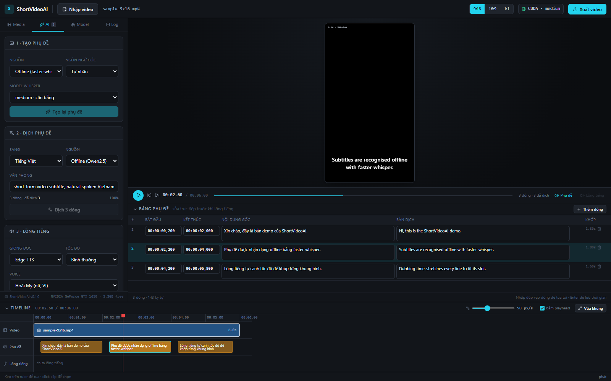
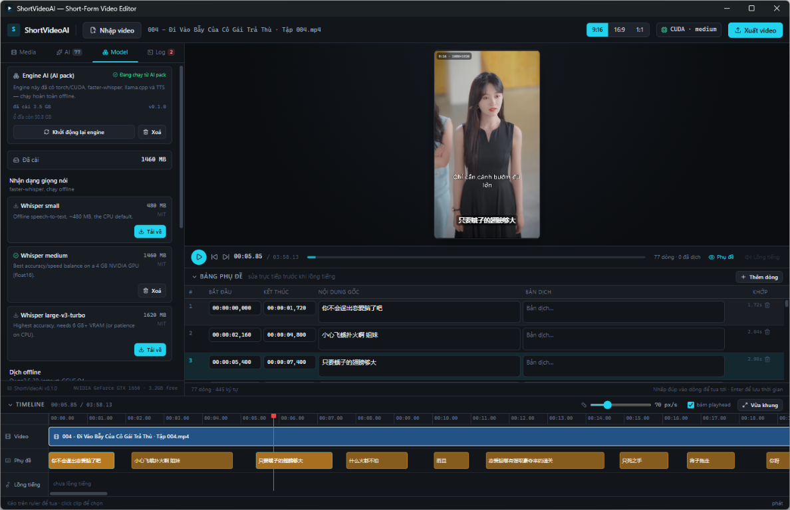

# ShortVideoAI

> Tiếng Việt | [English](README.en.md)

Trình dựng video ngắn cho Windows (Windows-first): nhập một clip dọc, bóc phụ đề offline,
dịch phụ đề, tạo bản lồng tiếng khớp thời lượng rồi xuất MP4 cuối — tất cả chạy trên máy
cục bộ.

**Công nghệ:** Tauri v2 + React 19 + TypeScript + Vite + Tailwind + Zustand →
engine FastAPI (Python 3.12) → FFmpeg + faster-whisper + llama.cpp (Qwen2.5 / Gemma 3) +
CapCut TTS / OmniVoice / VoiceStudio + audio-separator.



---

## Mục lục

- [Tính năng](#tính-năng)
- [Yêu cầu](#yêu-cầu)
- [Bắt đầu nhanh (dev)](#bắt-đầu-nhanh-dev)
- [Lần chạy AI đầu tiên: model](#lần-chạy-ai-đầu-tiên-model)
- [API key, model online và cài đặt](#api-key-model-online-và-cài-đặt)
- [Cấu hình](#cấu-hình)
- [Dữ liệu, model và log](#dữ-liệu-model-và-log)
- [Build bản phát hành](#build-bản-phát-hành)
- [AI pack (tuỳ chọn)](#ai-pack-tuỳ-chọn)
- [Cách app đóng gói chạy](#cách-app-đóng-gói-chạy)
- [Script kiểm tra](#script-kiểm-tra)
- [Cấu trúc dự án](#cấu-trúc-dự-án)
- [Xử lý sự cố](#xử-lý-sự-cố)

---

## Tính năng

| # | Tính năng | Cách hiện thực |
|---|-----------|----------------|
| 1 | Nhập & xem trước video ngắn, 9:16 / 16:9 / 1:1 | Trình phát HTML5 qua giao thức `asset://` của Tauri, phụ đề phủ ngay trong khung hình |
| 2 | Tự động tạo phụ đề, mặc định chạy offline | faster-whisper (CTranslate2) có VAD; tuỳ chọn STT cloud Groq / OpenAI, CapCut / Bilibili BCut, hoặc OCR đọc phụ đề cứng (chia theo tốc độ và độ chính xác); dòng bị nhận dạng sai được đọc lại ngay trên khung hình của nó, có hỏi trước khi thay |
| 3 | Dịch đa ngôn ngữ, giữ nguyên mốc thời gian | Qwen2.5 3B hoặc Gemma 3 4B (GGUF) qua llama.cpp chạy cục bộ — chọn trong **Cài đặt → Dịch offline**, hoặc Gemini / OpenAI |
| 4 | Lồng tiếng tự động khớp từng câu | CapCut (cloud, mặc định) / OmniVoice (k2-fsa, chạy torch offline) / VoiceStudio (server nội bộ kiểu OpenAI) + FFmpeg `atempo`, tỉ lệ tốc độ bị chặn bởi `SVA_MAX_TEMPO_RATIO` (1.35); âm thanh gốc được giữ lại và tự hạ nhỏ dưới giọng lồng tiếng; từng dòng nghe lại hoặc đọc lại riêng rồi ghép vào track, không phải lồng tiếng lại cả clip |
| 5 | Xuất bản cuối | FFmpeg: crop/scale theo tỉ lệ đã chọn, burn phụ đề ASS, trộn giọng lồng lên track nền; kiểu chữ / màu / vị trí phụ đề chỉnh được ngay trong app, xuất kèm tệp `.ass` (có style) hoặc `.srt` (chữ thuần) |
| 6 | Lưu / mở dự án, không mất việc khi đóng app | Tệp `.svaproj` (JSON) chứa clip, phụ đề, bản dịch, track lồng tiếng, thiết lập và vị trí playhead; `Ctrl+S` / `Ctrl+Shift+S` / `Ctrl+O`; mọi thay đổi còn được tự lưu vào `projects\_session.json` và khôi phục ở lần chạy sau |
| 7 | Nhập API key và tên model ngay trong app | Tab **Cài đặt** → `<data>\settings\providers.json`: key riêng cho từng nhà cung cấp, endpoint tuỳ chỉnh, tên model gõ tự do, kèm nút kiểm tra kết nối liệt kê các model mà key dùng được |
| 8 | Xuất dự án sang CapCut để sửa tiếp | `POST /api/export/capcut` ghi một draft CapCut Desktop thật (`draft_content.json` + `draft_meta_info.json` + mục trong `root_meta_info.json`): video, từng dòng phụ đề và từng câu lồng tiếng nằm trên track riêng, cắt / đổi chữ / đổi giọng tiếp được bên CapCut thay vì nhận một tệp MP4 đã burn cứng |

Ngoài ra: model manager tải theo luồng có tiến trình trực tiếp, tự nhận GPU (CUDA/float16
so với CPU/int8), tiến trình job trực tiếp qua WebSocket, bảng phụ đề sửa được, timeline ba
track, engine chạy dạng sidecar do shell desktop giám sát.

---

## Yêu cầu

| Công cụ | Phiên bản | Ghi chú |
|---------|-----------|---------|
| Windows | 10/11 x64 | WebView2 runtime (Windows 11 có sẵn) |
| Node.js | ≥ 20.19 | `node --version` |
| Python | 3.12 | `py -3.12`; script setup từ chối bản Python cũ hơn |
| Rust | ≥ 1.77.2 | `cargo --version`, toolchain MSVC (chỉ cần cho shell desktop / build) |
| FFmpeg | bản build gần đây | `winget install Gyan.FFmpeg`; tự động được đóng gói vào installer |
| GPU | tuỳ chọn | NVIDIA với CUDA 12.x cho wheel torch `cu130`; CPU vẫn chạy được với model nhỏ |

Dung lượng: ~5 GB cho môi trường dev, ~10 GB trống cho một lần build engine `full`
(thư mục làm việc + bundle 3,5 GB). Model AI tải riêng (xem bên dưới).

---

## Bắt đầu nhanh (dev)

```powershell
# 1. Cài mọi thứ (venv, thư viện Python, AI stack, ffmpeg, kiểm tra Rust, npm install)
npm run setup

# 2. Kiểm tra môi trường
npm run check

# 3. Chạy engine + shell desktop
npm run dev
```

`npm run dev` chạy song song hai tiến trình:

- `npm run dev:backend` — FastAPI tại `http://127.0.0.1:8756` (uvicorn `--reload`)
- `npm run dev:app` — `tauri dev` (Vite tại `http://localhost:1420`, bản build debug của Rust)

### Chỉ phát triển phần UI

Nếu không cần shell desktop (không có hộp chọn tệp, video phát qua `file://`):

```powershell
npm run dev:backend     # terminal 1
npm run dev:web         # terminal 2 -> http://localhost:1420
```

Thêm `?demo` vào URL (`http://localhost:1420/?demo`) để nạp clip mẫu đi kèm vào timeline,
bảng phụ đề và lớp phủ mà không cần nhập tệp.

### Tuỳ chọn khi setup

```powershell
npm run setup -- -CoreOnly     # chỉ thư viện server, không torch / AI wheels
npm run setup -- -SkipAi       # chỉ torch, bỏ qua whisper / TTS / LLM
npm run setup -- -ForceCpu     # cố ý cài bản torch cho CPU
npm run setup -- -SkipRust     # bỏ qua bước kiểm tra cargo
npm run setup -- -OcrGpu       # OCR chạy GPU: đổi ONNX Runtime sang bản DirectML
npm run setup -- -OcrCuda      # OCR chạy GPU: bản CUDA (NVIDIA + cuDNN 9)
```

Script chạy lặp lại an toàn: bước nào đã đạt yêu cầu thì được bỏ qua.

---

## Lần chạy AI đầu tiên: model

Trọng số (weights) **không** nằm trong repo. Mở tab **Model** trong app và tải những gì bạn
cần (`%APPDATA%\ShortVideoAI\models`):

| Nhóm | Key | Dung lượng | Dùng cho |
|------|-----|------------|----------|
| stt | `whisper-small` / `whisper-medium` / `whisper-large-v3-turbo` | 480 MB / 1,5 GB / 1,6 GB | bóc phụ đề cục bộ (kích thước theo `SVA_GPU_PRESET`) |
| llm | `qwen2.5-3b-instruct-q4_k_m` | ~2 GB | dịch offline, bản mặc định — nhanh nhất mỗi dòng |
| llm | `gemma3-4b-it-q4_k_m` | ~2,4 GB | dịch offline, bản 4B của Google — chậm hơn mỗi dòng, chọn ở **Cài đặt → Dịch offline** |
| tts | `omnivoice-v1` | 3,3 GB | giọng đọc offline tuỳ chọn: `pip install omnivoice` cho runtime, snapshot `k2-fsa/OmniVoice` về `models\tts\omnivoice-v1` ở câu lồng tiếng đầu tiên. Mặc định vẫn là CapCut (chỉ cần Internet) và VoiceStudio (server riêng, xem bên dưới) |
| separator | `uvr-mdx-inst-hq3` | 110 MB | tuỳ chọn: tách giọng/nhạc khi cần một bed nhạc thuần, và cho chế độ **Giọng sạch** khi lấy phụ đề |
| ocr | `ocr-ppocrv6-tiny` | 31 MB | tuỳ chọn cho profile OCR nhanh (det tiny + rec small); bộ `small` mặc định đi kèm engine OCR |
| ocr | `ocr-korean-v5` | ~30 MB | phụ đề cứng tiếng Hàn (PP-OCRv6 chưa có bộ nhận dạng tiếng Hàn) |

Model được tải theo luồng qua engine, có tiến trình trực tiếp, ghi vào tệp `.part` và chỉ
được chuyển thành tệp chính thức khi tải xong, nên tải bị ngắt không bao giờ để lại tệp
trọng số hỏng (huỷ giữa đường thì lần sau tải lại từ đầu).
Các nhà cung cấp cloud (Groq / OpenAI / Gemini) chỉ cần API key — không cần model; CapCut và
VoiceStudio gọi HTTP nên cũng không có trọng số để tải.

---

## API key, model online và cài đặt

AI online không còn phụ thuộc `backend/.env`: tab **Cài đặt** ghi
`<data>\settings\providers.json` qua `GET/PUT /api/settings`, và mọi service đọc chồng tệp
này lúc chạy. Thứ tự ưu tiên là **giá trị đã lưu thắng, biến môi trường chỉ để mồi**: lần
chạy đầu, các biến `SVA_*` / `GROQ_API_KEY` … được chép vào tệp để `.env` sẵn có hiện ra
đã điền sẵn; từ đó trở đi, cái gì trong panel là cái được dùng.

Mỗi nhà cung cấp (Gemini, OpenAI, Groq, VoiceStudio) có: API key, endpoint tuỳ chỉnh (proxy,
host khu vực hoặc gateway tương thích OpenAI) và ô tên model gõ tự do — model mới ra mắt
dùng được ngay, không cần cập nhật app. Nút **Kiểm tra** gửi một yêu cầu thật và liệt kê
các model mà key chạm tới được; bấm vào một mã là điền vào ô. Bản thân key không rời khỏi
engine: API chỉ trả về `api_key_set`.

Với Gemini, engine còn chỉnh *hình dạng request* theo model đang chọn để không chạm hạn mức
Free Tier: `gemini-3.1-flash-lite` gom 40 câu/lượt với `ThinkingLevel.MINIMAL` và nghỉ 4 s
giữa hai lượt — rẻ nhất cho phim dài, phụ đề đơn giản; `gemini-4-hydrogen` gom 28 câu/lượt,
`ThinkingLevel.LOW`, nghỉ 3 s — giữ mạch hội thoại, xưng hô và văn phong phim tốt hơn. Model
khác (2.5 Flash/Pro, model của proxy) dùng lô 20 câu và không gửi thinking level, vì dòng 2.5
nhận *budget* chứ không nhận *level*. Khoảng nghỉ chỉ tính thời gian rảnh sau khi câu trả lời
đã về, và job vẫn huỷ được trong lúc chờ.

| Panel | Ghi vào | Dùng cho |
|-------|---------|----------|
| API key & model online | `providers.<tên>.{api_key, base_url, model, stt_model}` | dịch (Gemini / OpenAI), nhận dạng giọng nói (Groq / OpenAI), lồng tiếng (VoiceStudio) |
| Dịch offline (GGUF) | `llm.model` | chọn trọng số cho nhà cung cấp `local`: `qwen2.5-3b-instruct-q4_k_m` (mặc định) hoặc `gemma-3-4b-it-q4_k_m`; chuỗi rỗng quay về mặc định. Mỗi GGUF được nạp bằng đúng chat template của nó — chatml cho Qwen, `<start_of_turn>` cho Gemma (Gemma không có vai system nên phần luật xưng hô đi trong lượt user) — và khi đổi model, model cũ được nhả khỏi VRAM trước khi model mới được nạp |
| OCR | `ocr.engine`, `ocr.profile`, `ocr.region`, `ocr.device` | `small` = PP-OCRv6 det + rec small, đi kèm engine, chính xác nhất; `tiny` = det tiny + rec small, nhanh gần gấp đôi, cần tải `ocr-ppocrv6-tiny`. Tiếng Hàn luôn dùng PP-OCRv5; tiếng Nhật ở chế độ `tiny` tự lùi về bộ dò small. `ocr.region` là vùng quét `trái,trên,phải,dưới` theo % khung hình — logo, tên kênh hay chữ quảng cáo nằm ngoài vùng không bị đọc thành dòng phụ đề; chuỗi rỗng quay về dải mặc định (`0,55,100,100`). `ocr.device` = `auto` / `gpu` / `cpu` chọn nơi đọc khung hình |
| Âm thanh khi lấy phụ đề | `audio.mode` | `fast` nhận dạng trên nguyên bản âm thanh; `clean` tách giọng trước (`uvr-mdx-inst-hq3` qua audio-separator), khử nhiễu (`afftdn` + `loudnorm`) rồi nhận dạng bản vocal 16 kHz mono — chiêu của CapCap cho clip có nhạc lấn giọng. Thiếu gói hoặc thiếu trọng số thì tự lùi về `fast` kèm cảnh báo, không làm hỏng job |

Engine OCR chỉ đọc trọng số từ `<data>\models\ocr` khi thư mục đó đã có tệp `*.onnx`, nên
bản cài mới vẫn dùng cặp đi kèm và không phải tải gì ở lần chạy đầu.

Vùng quét được vẽ ngay trong panel theo đúng tỉ lệ khung hình của video đang mở (9:16, 16:9,
1:1): kéo chuột để chọn, gõ bốn số % cho chính xác, hoặc bấm preset *Dưới 45 %* / *Dưới 30 %* /
*Trên 30 %* / *Toàn khung*. Bấm **Vùng OCR** ở thanh xem trước để vẽ trực tiếp trên video thật:
phần ngoài vùng bị làm mờ, phép đo bám vào điểm ảnh video nên clip 16:9 nằm trong dự án 9:16
vẫn đúng, và thả chuột là lưu ngay. Mỗi khung hình được cắt bằng `crop` của FFmpeg trước khi đưa
vào OCR, nên phần ngoài vùng không tốn thời gian nhận dạng và không thể sinh dòng rác; giá trị
hỏng trong tệp cấu hình thì bị bỏ qua kèm cảnh báo và lùi về dải mặc định, job không gãy.

Đọc khung hình là nửa tốn thời gian nhất của OCR, nên `ocr.device` mặc định là `auto`: engine dùng
GPU khi gói onnxruntime đang cài có provider đồ hoạ, còn không thì đọc bằng CPU. Ba bản ONNX Runtime
(`onnxruntime`, `onnxruntime-directml`, `onnxruntime-gpu`) đều cài **cùng một** gói `onnxruntime`,
nên "dùng GPU" là một lần *đổi gói*, không phải thêm dòng requirements:

```powershell
npm run setup -- -OcrGpu     # DirectML — mọi card DX12 (NVIDIA, AMD, Intel), không cần CUDA
npm run setup -- -OcrCuda    # onnxruntime-gpu — NVIDIA + CUDA 12 + cuDNN 9

# hoặc bằng tay, sau khi đã cài requirements-ai.txt:
pip uninstall -y onnxruntime onnxruntime-directml onnxruntime-gpu
pip install -r backend/requirements-ocr-gpu.txt
```

Bản DirectML không cần driver CUDA nên là lựa chọn an toàn cho máy phổ thông; bản CUDA nhanh hơn khi
máy đã có sẵn CUDA 12 + cuDNN 9. `pip install -r requirements-ai.txt` (hoặc `npm run setup` không kèm
cờ) sẽ cài lại bản CPU (requirements-ai.txt có `onnxruntime`), nên lần nào cài lại AI stack thì chạy kèm `-OcrGpu` /
`-OcrCuda` — script giữ lại đúng bản đang có nếu bạn không nêu cờ. Chọn `cpu` trong Cài đặt thì GPU
không được đụng tới dù đang cài bản GPU; chọn `gpu` chỉ là *ưu tiên*: lúc nạp engine, một khung hình
trắng được đọc thử, nếu driver/CUDA runtime thiếu thì reader được dựng lại trên CPU kèm cảnh báo thay
vì gãy giữa job. Panel Cài đặt nói thật điều đang chạy (**Đang đọc bằng GPU / CPU**, kèm tên gói ONNX
và danh sách provider), và log của job ghi `rapidocr · GPU` hay `rapidocr · CPU`.

Một dòng đã lỡ nhận dạng sai — do giọng nói hay do OCR — thì không phải chạy lại cả clip: bấm biểu
tượng **quét** trên dòng đó ở bảng phụ đề, hoặc biểu tượng **quét** ở tiêu đề bảng để đọc lại dòng
đang chọn trên timeline (dòng được chọn và playhead nhảy tới đầu dòng). Engine đọc
lại 1–3 khung nằm giữa khoảng thời gian của dòng, cùng vùng quét và cùng engine đang cấu hình, qua
`POST /api/subtitles/ocr-frame`. Kết quả hiện trong hộp thoại xác nhận: khung vừa đọc (chính là phần
ảnh đưa vào OCR, nhìn ra ngay nếu vùng quét lệch), dòng hiện tại và dòng đọc lại được — sửa tay được,
và khi các khung đọc ra khác nhau thì chọn một phương án. Chỉ khi bấm **Thay thế dòng này** mới ghi
vào phụ đề: nội dung gốc đổi, mốc thời gian giữ nguyên; bản dịch cũ vẫn còn nên cần dịch lại, và track
lồng tiếng được đánh dấu cần chạy lại. **Giữ nguyên** thì không có gì thay đổi. Nếu vùng quét không
thấy chữ nào, hộp thoại nói rõ để chỉnh vùng trong Cài đặt rồi bấm **Đọc lại**.

### Nghe và đọc lại từng dòng

Sửa chữ của một dòng không còn nghĩa là lồng tiếng lại cả video. Mỗi dòng trong bảng phụ đề có
hai nút thoại:

- **Loa** — nghe dòng đó. Dòng đã có bản thu thì phát đúng tệp của nó, không tạo gì mới; bản lồng
  tiếng cũ chưa lưu `clip_path` thì tìm `line_NNN.aligned.wav` ngay cạnh track. Chỉ khi thật sự
  không có tệp nào, engine mới đọc thử một lần rồi phát — và đọc thử đọc **đúng câu đang thấy**,
  không rút gọn cho vừa slot (bước đó nạp model dịch), cũng không ghi gì vào track. Bấm lần nữa để
  dừng; mở video khác cũng dừng.
- **Mũi tên tròn** — đọc lại dòng đó rồi ghép vào track. Chỉ dòng này được tổng hợp lại (đo với
  đúng khoảng thời gian của nó, vẫn dùng `atempo` và vẫn được rút gọn câu nếu quá dài, như khi
  lồng tiếng cả bài), các dòng khác giữ nguyên tệp đã thu, và track được dựng lại từ đầu bằng
  `POST /api/dubbing/remix`. Nút này cần có track lồng tiếng trước; dòng thêm sau khi lồng tiếng
  vẫn ghép vào được.

Hai nút chạy qua `POST /api/dubbing/cue` với `audition: true` (chỉ nghe) hay `audition: false`
(giữ bản thu). Mỗi bản thu nằm cạnh track trong thư mục tạm của lần lồng tiếng và đường dẫn được
ghi vào `dub.segments[].clip_path` của dự án, nên mở lại dự án vẫn nghe lại được.

Mỗi bản thu còn nhớ nội dung đã đọc trước khi bị rút gọn (`source`), nên dòng nào sửa chữ mà audio
vẫn là bản cũ thì nút mũi tên tròn chuyển **màu vàng** — bấm là đọc lại riêng dòng đó. Chấm cảnh
báo “cần lồng tiếng lại” ở tiêu đề bảng chỉ tắt khi mọi dòng đã khớp lại, kể cả khi bạn sửa nhiều
dòng rồi mới đọc lại từng dòng một.

### Kiểu chữ, vị trí và xuất phụ đề

Biểu tượng **chữ** ở tiêu đề bảng phụ đề mở bảng kiểu: phông chữ (gõ tên bất kỳ font đã cài,
có gợi ý sẵn), cỡ chữ, màu chữ và màu viền, in đậm, độ dày viền, nền chữ kèm màu và độ mờ, vị trí
trên / giữa / dưới, căn trái / giữa / phải, khoảng cách mép và lề hai bên. Mọi thay đổi hiện ngay
trên khung xem trước và được lưu vào dự án (`subtitle_style`), nên lần sau mở lại vẫn đúng kiểu.

Cùng một kiểu đó được ghi vào tệp `.ass` khi render — bản burn-in và khung xem trước dùng chung
một bộ số (cỡ chữ tính theo % chiều cao khung, lề tính theo %, `BorderStyle 3` cho nền hộp) — nên
xuất ra không bị "xem một kiểu, render một kiểu".

Hai nút **.ass** / **.srt** trong bảng xuất phụ đề ra tệp rời qua `POST /api/subtitles/export`:
`.ass` mang đúng kiểu chữ và vị trí đang đặt (dùng cho CapCut, Premiere, ffmpeg), `.srt` là chữ
thuần cho YouTube và các nền tảng khác. Tệp được ghi vào chỗ bạn chọn, mặc định cạnh video gốc.

### Xuất sang CapCut để sửa tiếp

Khối **CapCut** trong tab **Media** (nút *Xuất sang CapCut*) không render ra video mà ghi một dự án
CapCut Desktop thật: engine tự dò thư mục draft của bản CapCut đang cài
(`%LOCALAPPDATA%\CapCut\User Data\Projects\com.lveditor.draft`), tạo một thư mục draft mới rồi thêm
nó vào danh sách dự án trong `root_meta_info.json`. Mở CapCut là thấy dự án nằm trong màn hình chính.

Bên trong draft mọi thứ vẫn sửa được, vì mỗi thứ là một clip riêng:

| Track | Nội dung |
|-------|----------|
| Video | Clip gốc, tham chiếu tại chỗ (không copy), đã canh đúng tỉ lệ khung |
| Phụ đề | Mỗi dòng phụ đề là một text clip: chữ, font, màu, viền, nền, vị trí và cỡ chữ lấy từ bảng kiểu của app |
| Lồng tiếng | Mỗi câu là một audio clip đặt đúng mốc thời gian; âm thanh gốc nằm dưới ở mức `background_gain` |

Vài chi tiết đáng biết:

- Cỡ chữ trong draft dùng cùng bộ số với bản burn ASS (4,2 % chiều cao khung × hệ số slider), nên
  xem trong CapCut và xem trong app cho ra cùng một cỡ.
- CapCut không cho hai segment chồng thời gian trên một track, nên các dòng chồng nhau được tự tách
  sang track phụ (có cảnh báo trong kết quả).
- `GET /api/export/capcut/targets` cho biết thư mục draft, phiên bản CapCut, số dự án đang có và
  CapCut có đang mở hay không. Đang mở thì vẫn xuất được, nhưng phải khởi động lại CapCut mới thấy
  dự án mới, vì CapCut ghi lại danh sách lúc thoát.
- Trước khi sửa `root_meta_info.json`, engine lưu một bản sao nguyên văn vào
  `<data>\cache\capcut_index_before_<draft_id>.bak`; nếu CapCut ghi đè danh sách trong lúc xuất thì
  lần xuất đó dừng lại và draft vẫn nằm nguyên trên đĩa.
- Máy chưa cài CapCut thì draft được ghi vào `<data>\exports\capcut\` — chép cả thư mục vào chỗ
  draft của CapCut là dùng được. Nút **Chọn…** cho phép chỉ định thư mục khác.
- CapCut đọc font theo đường dẫn tuyệt đối, nên thiếu font trên máy thì draft vẫn mở được và cảnh
  báo sẽ nhắc bạn chọn lại font trong CapCut.

---

## Cấu hình

Sao chép tệp mẫu rồi sửa — engine đọc `backend/.env` khi khởi động:

```powershell
Copy-Item backend\.env.example backend\.env
```

Các biến hay thay đổi:

| Biến | Mặc định | Ý nghĩa |
|------|----------|---------|
| `SVA_PORT` | `8756` | cổng engine khi dev (bản đóng gói tự chọn cổng trống) |
| `SVA_DEVICE` | `auto` | `auto` / `cuda` / `cpu` / `directml` |
| `SVA_GPU_PRESET` | `max` | `max` (whisper medium fp16 + LLM trên GPU), `safe`, `cpu` |
| `SVA_MAX_TEMPO_RATIO` | `1.35` | mức tăng tốc tối đa cho lồng tiếng |
| `SVA_STT_PROVIDER` | `local` | `local` / `groq` / `openai` |
| `SVA_TRANSLATE_PROVIDER` | `local` | `local` / `gemini` / `openai` |
| `SVA_TTS_PROVIDER` | `capcut` | `capcut` / `omnivoice` / `voicestudio` |
| `SVA_OMNIVOICE_LANGUAGE` | `vi` | ngôn ngữ đọc của OmniVoice (`vi`, `en`, …) — khai báo giúp model không đoán sai từ đồng âm |
| `SVA_SOURCE_LANGUAGE` / `SVA_TARGET_LANGUAGE` | `auto` / `vi` | ngôn ngữ nguồn khi bóc phụ đề và ngôn ngữ đích khi dịch |
| `GROQ_API_KEY`, `OPENAI_API_KEY`, `GEMINI_API_KEY` | – | chỉ dùng cho nhà cung cấp cloud; các biến này *mồi* `providers.json` ở lần chạy đầu (nên nhập key trong tab **Cài đặt**) |
| `SVA_AI_PACK_URL` | – | link tải AI pack mặc định hiện trong **Model → Engine AI** (xem bên dưới) |

Key, tên model, profile OCR và chế độ âm thanh thường được nhập trong tab **Cài đặt**. Các
biến ở trên chỉ được đọc một lần để điền sẵn tệp đó; sau đó tệp là nguồn đúng, và xoá key
trong UI sẽ quay về dùng biến môi trường.

Ghi đè phía frontend (`.env.local` trong `frontend/`): `VITE_BACKEND_PORT`,
`VITE_BACKEND_HOST`, `VITE_API_TIMEOUT_MS`.

---

## Dữ liệu, model và log

Mọi thứ engine ghi ra đều nằm ngoài thư mục cài đặt:

```
%APPDATA%\ShortVideoAI\
├── models\        trọng số Whisper / LLM / TTS / tách nhạc / OCR
├── cache\         audio đã giải mã, wav trung gian, bản sao root_meta_info.json trước mỗi lần thêm draft CapCut
├── settings\providers.json  API key, tên model, profile OCR, chế độ âm thanh
├── projects\      tệp dự án: `<tên>.svaproj`, `_session.json` (tự lưu), `audio\` (track lồng tiếng của dự án)
├── renders\       video đã xuất
├── exports\capcut\  draft CapCut dự phòng cho máy chưa cài CapCut
├── logs\engine.log  log xoay vòng (log duy nhất trong bản đóng gói)
├── ai-pack\       engine AI tuỳ chọn (chỉ có khi cài từ tab Model)
└── temp\          track lồng tiếng, tệp ASS, thumbnail
```

Bản đóng gói chạy dạng cửa sổ (`--noconsole`), nên **`logs\engine.log` là nơi cần xem** khi
có lỗi; banner lỗi trong UI in ra đúng đường dẫn đó.

---

## Build bản phát hành

Hai profile:

| Flavor | Dung lượng engine | Nội dung |
|--------|-------------------|----------|
| `core` (mặc định) | ~110 MB | server, API REST/WS, pipeline FFmpeg, model manager. Các bước AI sẽ báo lỗi rõ ràng *"needs faster-whisper / llama-cpp-python …"* cho tới khi cài AI pack tuỳ chọn |
| `full` | ~3,5 GB | tất cả ở trên + torch/CUDA, CTranslate2, llama.cpp, ONNX Runtime, audio-separator, kèm SDK cloud mà các nhà cung cấp online dùng (`openai`, `google-genai`) |

```powershell
# Chỉ engine (PyInstaller onedir, noconsole) + smoke test trên /api/health
npm run build:backend             # core  (~2 phút)
npm run build:backend:full        # full  (5-20 phút, ~3,5 GB)

# Bản phát hành đầy đủ: engine -> Vite build -> Tauri release -> NSIS installer
npm run build:windows             # core
npm run build:windows:full        # full
```

Sản phẩm tạo ra:

```
frontend/src-tauri/resources/engine/    shortvideoai-engine.exe + _internal\
frontend/src-tauri/resources/ffmpeg/    ffmpeg.exe, ffprobe.exe (chép từ PATH)
frontend/src-tauri/target/release/      short-video-ai.exe (+ engine\, ffmpeg\)
release/ShortVideoAI_0.1.0_x64-setup.exe
```

`build_windows.ps1` in ra dung lượng và SHA256 của installer. Vài tuỳ chọn hữu ích:

```powershell
powershell -File scripts/build_windows.ps1 -Flavor core -SkipBackend   # dùng lại bundle engine
powershell -File scripts/build_backend.ps1 -Clean -SkipSmokeTest       # build sạch, không chạy smoke test
```

> **Giới hạn dung lượng:** NSIS là container 32-bit, không thể tạo installer lớn hơn 2 GB,
> nên profile `full` không đóng gói được thành một gói NSIS duy nhất. Hãy phát hành installer
> `core` kèm AI pack tuỳ chọn ở dưới (`-SkipBundle` vẫn build app mà không tạo installer nếu
> bạn muốn dạng thư mục portable).

---

## AI pack (tuỳ chọn)

Bản cài `core` (~161 MB) chạy toàn bộ editor: timeline, xem trước, pipeline FFmpeg, model
manager và API. AI stack — torch/CUDA, CTranslate2, llama.cpp, ONNX Runtime, audio-separator —
không vừa NSIS, nên được phát hành thành **một tệp zip cài theo nhu cầu**.

```powershell
npm run build:pack                       # dùng lại build\dist-full\engine
powershell -File scripts\make_ai_pack.ps1 -BuildEngine      # chạy PyInstaller trước (5-20 phút)
powershell -File scripts\make_ai_pack.ps1 -Level 9 -Force   # archive nhỏ hơn, build lâu hơn
```

Kết quả: `release\ShortVideoAI_0.1.0_ai-pack-full.zip` (≈2,1 GB, ~3,5 GB khi giải nén) kèm
SHA256. Archive chỉ là bản sao của bundle engine `full`:

```
ai-pack.json                     schema, phiên bản, profile, số tệp/số byte
engine\shortvideoai-engine.exe   bundle PyInstaller profile full
engine\_internal\...
```

Đặt ở bất kỳ host HTTPS nào rồi trỏ engine vào (hoặc để trống để người dùng chọn tệp `.zip`
trong máy):

```ini
SVA_AI_PACK_URL=https://example.com/ShortVideoAI_0.1.0_ai-pack-full.zip
```



Cài từ **Model → Engine AI**. Công việc được chia làm hai phần là có chủ ý, vì Windows khoá
tệp `.exe` và các DLL đang chạy:

| Bước | Phía thực hiện | Kết quả |
|------|----------------|---------|
| Tải | Engine Python | ghi theo luồng vào `temp\ai-pack-<ts>.zip` (không resume — lỗi là tải lại từ đầu) |
| Kiểm tra + giải nén | Engine Python | `ai-pack.staging\engine\...`, tiến trình qua `/ws/progress`, cần ~7 GB trống |
| Áp dụng | Shell Tauri (`apply_ai_pack`) | kill sidecar, thay `ai-pack\engine`, chuyển manifest, khởi động lại |
| Quay về bản lõi | Shell Tauri (`remove_ai_pack`) | xoá `ai-pack\`, chạy lại engine đi kèm |

Bộ giám sát ưu tiên `%APPDATA%\ShortVideoAI\ai-pack\engine\shortvideoai-engine.exe` và quay
về `resources\engine\` khi không có, nên gỡ AI pack chỉ là xoá một thư mục. Sau khi hoán
đổi, WebView tải lại và đọc cổng mới; `GET /api/health` cho biết engine đang chạy từ đâu:

```json
"runtime": { "engine_path": "...\\ai-pack\\engine\\shortvideoai-engine.exe",
             "frozen": true, "ai": true, "ai_pack": true }
```

Lưu ý:

- **Phải build lại pack mỗi khi mã engine thay đổi.** Pack là bản đóng băng của `backend/`:
  bản cũ vẫn khởi động được nhưng bề mặt `/api/*` là của mã cũ (ví dụ `/api/ai-pack` trả 404
  và thẻ trạng thái đứng ở *Đang kiểm tra…*). Chạy `npm run build:pack` sau mỗi thay đổi
  backend sẽ phát hành.
- Cài khi app đang chạy sẽ để lại thư mục mới sẵn sàng nhưng engine *cũ* vẫn sống — thẻ hiện
  **Khởi động lại engine** cho tới khi shell khởi động lại vào bản mới.
- Cập nhật app không bao giờ đụng tới `ai-pack\`; pack phiên bản mới chỉ đơn giản thay thế
  thư mục.
- Thư mục tạm vẫn còn nếu app sập giữa lúc hoán đổi; **dọn bản giải nén tạm** sẽ xoá nó.

---

## Cách app đóng gói chạy

```
short-video-ai.exe  (shell Tauri)
   │ 1. chọn một cổng loopback còn trống
   │ 2. spawn engine — %APPDATA%\ShortVideoAI\ai-pack\engine\… nếu đã cài AI pack,
   │    ngược lại resources\engine\shortvideoai-engine.exe
   │    SVA_PORT, SVA_PACKAGED=1, SVA_PARENT_PID=<pid của shell>, SVA_FFMPEG_DIR
   │ 3. chờ WebView gọi `backend_info`  -> cổng, runtime, đường dẫn log
   │ 4. kill engine khi thoát (RunEvent::Exit)
   ▼
shortvideoai-engine.exe (PyInstaller, windowed)
   └─ psutil watchdog: tự thoát nếu shell biến mất (bị kill từ Task Manager)
```

WebView biết cổng trước lần render đầu (`frontend/src/lib/desktop.ts`), nên client HTTP và
WebSocket luôn trỏ đúng địa chỉ — bản phát hành không dùng cổng cố định. Quyền `asset://`
được cấp **theo từng tệp** qua lệnh `grant_media_access`; CSP/scope tĩnh trong
`tauri.conf.json` để trống.

Bản debug không spawn sidecar (nó chờ `npm run dev:backend` ở cổng 8756). Đặt
`SVA_SIDECAR=1` để thử bộ giám sát ngay từ bản debug.

---

## Script kiểm tra

```powershell
.venv\Scripts\python.exe backend\scripts\verify_stack.py     # AI wheels + thiết bị tính toán
.venv\Scripts\python.exe backend\scripts\verify_stt.py       # vòng CapCut TTS -> faster-whisper
```

Khi engine đang chạy (`npm run dev:backend`):

```powershell
cd backend
$env:PYTHONPATH="."
..\.venv\Scripts\python.exe scripts\verify_pipeline.py       # probe -> lồng tiếng -> xuất -> render
```

Các endpoint AI pack cũng dùng được bằng tay (hữu ích khi debug máy người dùng):

```powershell
Invoke-RestMethod http://127.0.0.1:8756/api/ai-pack
Invoke-RestMethod http://127.0.0.1:8756/api/ai-pack/install -Method Post `
    -ContentType application/json -Body '{"path":"D:\ShortVideoAI_0.1.0_ai-pack-full.zip"}'
Invoke-RestMethod http://127.0.0.1:8756/api/jobs/<job-id>     # poll tới khi state=done
```

Kiểm tra tĩnh:

```powershell
npm run typecheck                                   # tsc --noEmit
npm run build                                       # tsc + vite production build
.venv\Scripts\python.exe -m ruff check app tests scripts packaging   # chạy trong backend\
cargo check                                         # chạy trong frontend\src-tauri
```

---

## Cấu trúc dự án

```
.
├── backend/
│   ├── app/
│   │   ├── api/          route REST, registry job, bus tiến trình WebSocket
│   │   ├── core/         nhận diện phần cứng, báo tiến trình
│   │   ├── services/     media_processor (FFmpeg), stt, translate, tts, model_manager, capcut_draft
│   │   ├── utils/        ghi phụ đề ASS/SRT
│   │   ├── schemas/      model request/response pydantic
│   │   ├── config.py     settings (env SVA_*), đường dẫn nhận biết bản frozen
│   │   └── main.py       app FastAPI, lifespan, watchdog tiến trình cha, entry uvicorn
│   ├── packaging/        spec PyInstaller, entry point frozen, runtime hook
│   ├── scripts/          verify_stack / verify_stt / verify_pipeline
│   └── requirements*.txt
├── frontend/
│   ├── src/
│   │   ├── components/   layout, media, ai, preview, subtitles, timeline
│   │   ├── hooks/        useEngine, useProgressSocket
│   │   ├── lib/          api, endpoint, desktop, media, player, tasks
│   │   ├── store/        store Zustand của editor (track, transport, job)
│   │   └── types/
│   └── src-tauri/        shell Rust: giám sát engine, capabilities, icon
├── scripts/              setup_dev, check_env, dev_backend, build_backend, build_windows
├── docs/screenshots/
└── package.json          npm workspaces + điểm vào các tác vụ
```

---

## Xử lý sự cố

| Hiện tượng | Cách khắc phục |
|------------|----------------|
| Banner: *Không kết nối được engine* (dev) | Chạy `npm run dev:backend`; kiểm tra `http://127.0.0.1:8756/api/health`. Có thể tiến trình khác đang giữ cổng: `Get-NetTCPConnection -LocalPort 8756` |
| Banner lỗi trong bản đóng gói | Đọc `%APPDATA%\ShortVideoAI\logs\engine.log`; banner in ra đúng đường dẫn |
| `device=cpu` dù máy có GPU | Wheel torch CPU đã thay bản CUDA — chạy lại `npm run setup` (cài lại torch từ index `cu130`) |
| OCR vẫn *Đang đọc bằng CPU* dù đã chọn `gpu` | Gói ONNX Runtime đang là bản CPU: `npm run setup -- -OcrGpu` (mọi card DX12) hoặc `-OcrCuda` (NVIDIA + cuDNN 9); với bản CUDA, kiểm tra `CUDA_PATH` trỏ tới CUDA 12 và `cudnn64_9.dll` có trên `PATH` |
| `pip install` báo *WinError 5: Access is denied* trên `onnxruntime\capi\*.dll` | App/engine đang chạy đã nạp thư viện nên tệp bị khoá: tắt app và tiến trình `uvicorn` trước rồi cài lại. Bản cài dở còn để lại `onnxruntime` nửa cũ nửa mới (import lỗi `set_default_logger_callback`), xử lý bằng `pip uninstall -y onnxruntime onnxruntime-directml onnxruntime-gpu` rồi cài lại, và chạy lại `npm run setup -- -OcrGpu` nếu máy dùng GPU |
| `ffmpeg: NOT FOUND` | `winget install Gyan.FFmpeg`, hoặc đặt `SVA_FFMPEG_DIR` tới thư mục chứa `ffmpeg.exe` |
| Bóc phụ đề chậm / lỗi VRAM | Hạ preset: `SVA_GPU_PRESET=safe` (whisper small) hoặc `cpu` |
| Tải model thất bại | Kiểm tra dung lượng trống và mạng; thử lại — tệp `.part` bị bỏ và tải lại từ đầu |
| `tauri build` báo *icons/icon.ico not found* | Tạo lại bằng `npx tauri icon` trong `frontend/` (icon đã commit, chỉ dành cho bản fork) |
| Lúc build installer báo >2 GB | Bạn đang ở profile `full` — xem [Build bản phát hành](#build-bản-phát-hành) |
| WebSocket không kết nối | Chỉ dùng loopback; VPN/tường lửa chặn `127.0.0.1` sẽ làm hỏng cả REST và WS |
| Bản `.ass` mở trong CapCut nhưng font bị thay | `.ass` chỉ ghi tên font; CapCut cần font đó có trên máy — dùng *Xuất sang CapCut* thay vì `.ass` để draft mang theo đường dẫn font tuyệt đối |
| Draft CapCut không hiện trong danh sách dự án | CapCut đang mở lúc xuất thì nó ghi lại danh sách khi thoát: đóng CapCut rồi xuất lại, hoặc mở `%LOCALAPPDATA%\CapCut\User Data\Projects\com.lveditor.draft\root_meta_info.json` xem có mục vừa thêm; bản sao trước khi sửa nằm ở `%APPDATA%\ShortVideoAI\cache\capcut_index_before_*.bak` |

API key cloud được đọc từ `backend/.env` (hoặc biến môi trường của tiến trình) và không bao
giờ ghi vào tệp dự án hay log.
